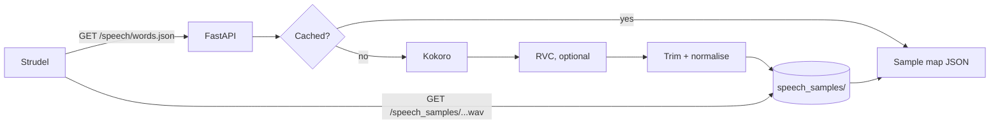

# strudel-tts

A local, [Shabda](https://shabda.ndre.gr/)-compatible text-to-speech sample server for [Strudel](https://strudel.cc/), built for Apple Silicon.

Words are spoken by [Kokoro-82M](https://huggingface.co/hexgrad/Kokoro-82M) via [mlx-audio](https://github.com/Blaizzy/mlx-audio), then optionally re-voiced with an [RVC](https://github.com/RVC-Project/Retrieval-based-Voice-Conversion-WebUI) model via [mlx-rvc](https://github.com/lextoumbourou/mlx-rvc). Everything runs on MLX — no CUDA, no cloud.

```js
samples('http://localhost:8000/speech/hello,big_world.json?strudel=1&voice=alice')
s("hello big_world")
```

## Features

- Shabda's `/speech/<words>.json` API, so Strudel (and Estuary) can load samples from it directly
- Fast Kokoro TTS on the GPU via MLX
- Optional RVC voice conversion to make samples sound like a specific person
- Every rendered sample is trimmed, peak-normalised and cached on disk, so repeats are instant
- All models are loaded and warmed up at startup, so the first request during a performance doesn't stall

Rough timings on an M1 (16 GB):

| Request | Time |
|---|---|
| New word, Kokoro only | ~0.25 s |
| Three new words with RVC | ~1.5 s |
| Any previously rendered word | ~10 ms |

## Requirements

- Apple Silicon Mac (M1 or later)
- [uv](https://docs.astral.sh/uv/)
- Python 3.11 or 3.12 (uv will fetch it if needed)

## Getting started

```sh
git clone <this-repo>
cd strudel-tts
uv sync --python 3.12
uv run strudel-tts
```

The first start downloads Kokoro (~330 MB) and a spaCy English model. If you add RVC voices, the ContentVec and RMVPE weights are also downloaded on first start.

### Options

| Flag | Default | Description |
|---|---|---|
| `--host` | `127.0.0.1` | Interface to bind to |
| `--port` | `8000` | Port to listen on |
| `--voices-dir` | `voices` | Directory of RVC voices |
| `--samples-dir` | `speech_samples` | Where rendered WAVs are cached |
| `--kokoro-model` | `mlx-community/Kokoro-82M-bf16` | Any Kokoro model on the Hugging Face Hub (e.g. the `-8bit` or `-4bit` variants) |

## Using it in Strudel

Strudel's built-in `shabda/speech:...` shortcut always points at `shabda.ndre.gr`, so pass the full URL to `samples()`:

```js
samples('http://localhost:8000/speech/one,two,three.json?strudel=1')
s("<one two three>*2")
```

Each word becomes a sample bank. Spaces in a definition become underscores, so `big world` is played with `s("big_world")`.

> Use Chrome or Firefox. Safari may block an `https://` page such as strudel.cc from fetching `http://localhost`. Chrome may ask for permission to access devices on your local network.

### Query parameters

| Param | Default | Description |
|---|---|---|
| `strudel` | – | Any non-empty value returns Strudel's sample-map format; otherwise Estuary's list format is returned |
| `gender`, `language` | `f`, `en-GB` | Same as Shabda; picks a Kokoro voice. Supports `en-US`, `en-GB`, `es`, `fr`, `hi`, `it`, `pt` |
| `kokoro` | – | A specific [Kokoro voice](https://huggingface.co/hexgrad/Kokoro-82M/blob/main/VOICES.md) such as `af_bella`; overrides `gender`/`language` |
| `voice` | – | Name of an RVC voice folder in `voices/` |
| `pitch` | `0` | RVC pitch shift in semitones (−24 to 24) |
| `speed` | `1.0` | Speaking speed (0.5 to 2.0) |

Shabda's `:n` variation suffix (e.g. `red:3`) is accepted for compatibility but ignored, as speech output is deterministic.

## Adding RVC voices

Put each voice in its own folder under `voices/`, then restart the server:

```
voices/
└── alice/
    ├── alice.pth      # required
    └── alice.index    # optional, improves similarity
```

Then use `voice=alice` in the URL.

Models must be **exported v2 RVC models with pitch guidance (f0)**, as produced by RVC WebUI or [Applio](https://github.com/IAHispano/Applio). Raw training checkpoints (e.g. `G_*.pth`, `f0G40k.pth`) won't load.

### Training a voice

This project only runs voices; it doesn't train them. [Applio](https://github.com/IAHispano/Applio) is the easiest trainer and runs on macOS (MPS), though it's slow on base M-series chips. A Google Colab GPU is the usual faster option. Aim for 10–30 minutes of clean, solo speech.

## How it works



| File | Responsibility |
|---|---|
| [src/strudel_tts/app.py](src/strudel_tts/app.py) | HTTP routes and Shabda-compatible responses |
| [src/strudel_tts/speech.py](src/strudel_tts/speech.py) | Kokoro → RVC → trim/normalise → cache |
| [src/strudel_tts/voices.py](src/strudel_tts/voices.py) | Kokoro voice mapping and RVC voice discovery |
| [src/strudel_tts/definition.py](src/strudel_tts/definition.py) | Parsing and validating word definitions |
| [src/strudel_tts/audio.py](src/strudel_tts/audio.py) | Silence trimming, normalisation and WAV I/O |

To clear the cache, delete `speech_samples/`.

## Responsible use

Only clone voices you have permission to use. Check the licence of any RVC model you download, and be mindful that the TTS and voice models used here have their own licences.

## Acknowledgements

- [Shabda](https://github.com/ilesinge/shabda) by ilesinge, whose API this mirrors
- [Strudel](https://strudel.cc/)
- [Kokoro](https://huggingface.co/hexgrad/Kokoro-82M) by hexgrad
- [mlx-audio](https://github.com/Blaizzy/mlx-audio) by Prince Canuma
- [mlx-rvc](https://github.com/lextoumbourou/mlx-rvc) by Lex Toumbourou

## License

Copyright 2026 pixelscript. Licensed under the [Apache License, Version 2.0](LICENSE).

This covers the code in this repository only. Dependencies, model weights and any RVC voices you use are covered by their own licences.
